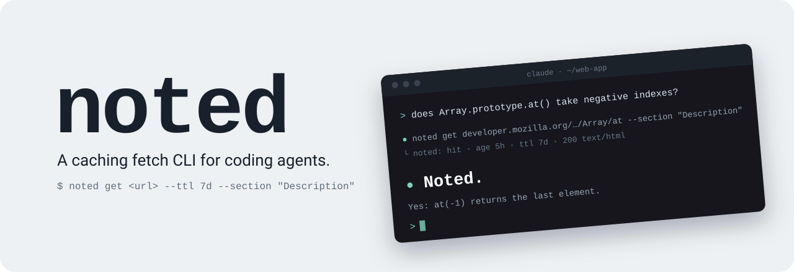

<p align="center">
  
</p>

noted is a fetch CLI for coding agents. It keeps web pages and API responses in a local cache and returns HTML as compact markdown. An agent can re-read the same docs page all session without another network request, and without dragging the whole page into its context.

```
$ noted get https://developer.mozilla.org/en-US/docs/Web/JavaScript/Reference/Global_Objects/Array/at --section Description
noted: hit · age 55s · ttl 7d · 200 text/html · 168KB
## [Description](#description)

The `at()` method is equivalent to the bracket notation when `index` is a non-negative integer. For example, `array[0]` and `array.at(0)` both return the first item. ...
```

That page is 168KB of HTML. As markdown it's 7KB, and the Description section on its own is under 2KB.

## Install

macOS and Linux:

```
curl --proto '=https' --tlsv1.2 -LsSf https://github.com/jacoobia/noted/releases/latest/download/noted-installer.sh | sh
```

Windows (PowerShell):

```
powershell -ExecutionPolicy Bypass -c "irm https://github.com/jacoobia/noted/releases/latest/download/noted-installer.ps1 | iex"
```

From source, with Rust 1.89 or newer:

```
cargo install --locked --git https://github.com/jacoobia/noted
```

## First run

noted won't make a request until it knows who is asking. The first `noted get` that needs the network exits with code 3 and asks the agent to check with you how its requests should identify themselves. There are three choices:

1. **Recommended:** the agent's name and version plus a way to reach you, e.g. `Claude-Code/2.1 (+mailto:you@example.com)`.
2. **Your own string.**
3. **The agent's usual User-Agent**, e.g. Claude Code's `Claude-User (claude-code/2.1.318; +https://support.anthropic.com/)`.

The agent saves your answer with:

```
noted config user-agent "Claude-Code/2.1 (+mailto:you@example.com)"
```

Nothing in the User-Agent mentions noted. Sites see the agent and the person running it, and can allow or block that agent in robots.txt the way they would if it fetched the page itself. Cached pages still load before this is set, because a cache hit makes no request.

## Usage

```
noted get <url> [--ttl <duration>] [--section <heading> | --outline] [--refresh] [--raw] [-q]
noted ls
noted rm <url>... | --stale | --all
noted stats
noted config user-agent [<value>]
```

| Option | What it does |
|---|---|
| `--ttl 7d` | How long the copy stays fresh: `5m`, `1h`, `7d`, `30d` and so on. A new entry defaults to 1 day. Later calls without `--ttl` keep the stored TTL. `0s` checks with the server every time. |
| `--section <heading>` | Prints one heading and everything under it, up to the next heading at the same level or higher. Matching ignores case, and the first match wins. When nothing matches, noted exits 1 and lists the headings it found. |
| `--outline` | Prints just the page's headings, to judge a long page before reading any of it. |
| `--refresh` | Checks with the server even when the copy is still fresh. |
| `--raw` | Prints HTML as the server sent it. Other content types, JSON included, always come back byte for byte, so `noted get <url> \| jq .name` works without it. |
| `-q` | Hides the status line. |

The body goes to stdout. A status line goes to stderr:

| Status | Meaning |
|---|---|
| `miss` | First fetch, now cached. |
| `hit` | Served from the cache, no request made. |
| `revalidated` | The copy had expired, the server said it hadn't changed (304), so the cached copy was served. |
| `refreshed` | The server sent a new copy. |
| `stale` | The server was unreachable, timed out or returned a 5xx, so you got the cached copy. A warning line explains why, even with `-q`. |

Any other HTTP error (404 and so on) isn't cached. noted exits 1, prints `noted: HTTP <code>` on stderr and nothing on stdout, so a script that saves stdout never mistakes an error page for content. Exit code 3 means no User-Agent is set yet (see [First run](#first-run)).

`noted ls` lists entries with their age, TTL, freshness, size, hit count and URL. `noted rm` removes entries and overwrites their bytes on disk. `noted stats` shows totals, where the cache file is, and which User-Agent is in use.

## How it works

Each URL is fetched once and stored with its TTL. While the TTL lasts, reads come from disk. Once it expires, noted sends the stored ETag or Last-Modified back to the server. Usually the answer is a 304, which costs a few hundred bytes instead of the full page. If the server can't be reached, you get the old copy and a warning instead of an error.

HTML is converted at read time. noted keeps the main content (`.mw-parser-output` on MediaWiki sites, else `main`, `article` or `body`), drops scripts, navigation, images, tables of contents and navboxes, and tidies tables so they stay readable as markdown. The original bytes stay in the cache, so `--raw` always has them.

Before any request for a page, noted checks the site's robots.txt for the product token in your User-Agent: the part before the first `/`, space or `(`, such as `Claude-Code` or `Claude-User`. A disallowed path is refused, and nothing is fetched or cached. The rules for each site are cached for a day. A site with no robots.txt allows everything. If robots.txt can't be reached, you get a stale copy of the page if there is one, and otherwise nothing.

Several agents can use the same cache at once. It's a single SQLite file in WAL mode.

## Using it with agents

The CLI works with any agent that can run shell commands. The simplest setup is a line in your project's `AGENTS.md` (or equivalent) asking the agent to use `noted get` for web pages instead of curl.

### Skill

`skill/SKILL.md` tells an agent when to use noted and how to pick a TTL. For Claude Code:

```
mkdir -p ~/.claude/skills/noted
curl -fsSL https://raw.githubusercontent.com/jacoobia/noted/main/skill/SKILL.md -o ~/.claude/skills/noted/SKILL.md
```

### Claude Code hook

`noted hook` handles PreToolUse events. Add it to `~/.claude/settings.json`:

```json
{
  "hooks": {
    "PreToolUse": [
      { "matcher": "Bash|WebFetch", "hooks": [{ "type": "command", "command": "noted hook" }] }
    ]
  },
  "permissions": {
    "allow": ["Bash(noted get:*)"]
  }
}
```

With it installed:

- A plain `curl <url>` becomes `noted get <url>`, and `curl <url> | jq ...` becomes `noted get --raw <url> | jq ...`. Only `-s`, `-S`, `-L`, `-f` and their long forms are accepted.
- Anything else is left alone. That covers headers, a method, a body, `-o`, credentials or tokens in the URL, curl globs, local hosts (localhost, `.local`, private IPs), more than one URL, a path like `/usr/bin/curl`, and any shell substitution, redirection or `;`/`&&`/`||` before the first pipe.
- WebFetch is denied with a message pointing the agent at `noted get`. Set `NOTED_ALLOW_WEBFETCH=1` to turn that off.

Rewritten commands go through the normal permission check, which is why the snippet allows `noted get`. In auto mode, Claude Code may hold back a rewritten call once and ask the model to issue it again. The hook exits 0 on any input, so it can't block a tool call by mistake.

## Configuration

| Variable | Effect |
|---|---|
| `NOTED_DB` | Path to the cache file. Defaults to `noted/cache.db` in the OS cache directory: `%LOCALAPPDATA%` on Windows, `~/Library/Caches` on macOS, `$XDG_CACHE_HOME` or `~/.cache` on Linux. |
| `NOTED_USER_AGENT` | User-Agent for this process, overriding the saved one. Useful when several agents share one cache and should each identify themselves. |
| `NOTED_CONFIG_DIR` | Where the saved User-Agent lives. Defaults to `noted` in the OS config directory: `%APPDATA%` on Windows, `~/Library/Application Support` on macOS, `$XDG_CONFIG_HOME` or `~/.config` on Linux. |
| `NOTED_TIMEOUT` | Request timeout, such as `10s`. Defaults to 30s. |
| `NOTED_ALLOW_WEBFETCH` | Set to `1` to stop the hook denying WebFetch. |

A User-Agent must be 1 to 256 printable ASCII characters. noted refuses anything else, so a bad value can't inject headers.

## Security and privacy

- Cached pages are stored unencrypted. `noted rm` overwrites removed pages on disk, and `noted rm --all` empties the cache.
- A cached page can contain text written to steer an agent, and it keeps serving that text until it expires. Treat fetched content as untrusted input, cached or not.
- noted only sends GET requests. The hook won't rewrite requests with auth headers, credentials, or common token and signature parameters in the URL. If you run `noted get` yourself on a URL that contains a secret, the URL and the response are cached like any other.

## Limitations

- Pages that build their content with JavaScript come back nearly empty. `--raw` shows what the server actually sent.
- Pages that aren't UTF-8 are decoded lossily when converted to markdown. `--raw` keeps the original bytes.
- On Windows, writing binary output straight to a console window fails. Pipe it or redirect it to a file instead.
- Responses over 20MB are refused.

## Contributing

See [CONTRIBUTING.md](CONTRIBUTING.md). Coding agents should follow [AGENTS.md](AGENTS.md).

## License

Licensed under either of [Apache License 2.0](LICENSE-APACHE) or [MIT license](LICENSE-MIT), at your option.
